# 62 — Region flavours: weather, hordes, island trials, Titans

Five features, each giving one region something of its own, as asked on 2026-11-01:

| Region | Feature | In one line |
| --- | --- | --- |
| Hoenn | **Weather** | A few areas always have the same weather (Route 119's rain, Route 111's sandstorm…), and it changes every battle there. |
| Kalos | **Hordes** (a bit rare) | Now and then a wild card is a horde: five of one species, fought two at a time. |
| Alola | **Island trials** | The seven captains' battles become Totem trials: a big Totem Pokémon with an aura that calls in allies. |
| Galar | **Weather** | The Wild Area's weather changes every day (the same for everyone), and changes the battles and which Pokémon come out. |
| Paldea | **Titans** | Five areas get a Titan as their boss: it fights, runs off, eats a Herba Mystica and comes back as a giant. |

**Built on 2026-11-01** (§10), every decision at its default: no answer came before the work started. Where the build
differs from the plan below, §10 says so.

## 1. Rules all five follow

- **Switch.** Each one gets the admin's Off / On for admin / On for everyone switch, Off by default, checked by the
  server too. That means five new keys for `side_quest_open(p_key)`: `hoennWeather`, `galarWeather`, `hordes`,
  `trials` and `titans`. Hoenn and Galar share the weather engine but have separate switches, so one can go live
  without the other.
- **Rules once, then INFO** (docs/15 §20). None of them has a page of its own, so each shows a rules pop-up the
  first time the player meets it. After that, an INFO button where it shows brings the rules back: on the weather
  chip, the horde's banner, the trial's card and the Titan's plate.
- **The engine decides everything.** A new `src/engine/weather.ts` handles the weather, `hordes.ts` the hordes,
  `trials.ts` the trials and `titans.ts` the Titans, all pure. The screens only show the state and the log.
- **Off is untouched.** With a switch off, its rule never runs and the random numbers aren't touched, so every
  existing test and save plays the same (the doubles switch works the same way, docs/33).
- **Same exclusions as doubles.** None of them run in Extreme mode, a small world, an area with a mode (the portal,
  the nightmare, a Safari) or a raid. A raid keeps its own weather (docs/40).
- **Text** goes only in `strings.csv`, in all ten languages. **Admin**: each one has its section, and its per-area
  data sits on the area in AreasSection. **Kitchen sink**: every new piece in every state.
- **Data**: each area's weather and the trials are the game's own content (`src/engine/flavoursContent.ts`, deep-merged
  under their config rows, as the rivals' meetings are); the Titans' bosses and Totem Kommo-o's gym row come from
  `scripts/patch-region-flavours.ts` (it writes the bundle, safe to run again). The new migrations come after 0113: 0114
  weather, 0115 hordes, 0116 trials, 0117 Titans. `supabase/seed.sql` carries the data, and the PGlite test runs each of
  them twice.
- **Branch**: `ccr-f432a8de-hqqe99`, so PR #42 into `version/2_9` (a new PR into `version/2_9` if #42 has been
  merged by then). Screenshots go in `docs/62-region-flavours/`, taken by an e2e spec, as for docs/61.

## 2. The weather engine (shared by Hoenn and Galar)

**The battle rules are the raids' own** (`raidSpecials.ts`: `weatherBoosts`, `WEATHER_SPARES`, `WEATHER_CHIP`), so a
weather means the same thing everywhere in the game:

| Weather | In battle (both sides) | Galar only: who comes out more |
| --- | --- | --- |
| Clear | nothing | nothing |
| Overcast | nothing (look only) | Normal, Dark |
| Rain | Water attacks ×1.25, Fire ×0.75 | Water, Electric, Bug |
| Thunderstorm | as rain | Electric, Water |
| Harsh sun | Fire attacks ×1.25, Water ×0.75 | Fire, Grass |
| Sandstorm | 4% of max HP lost each round, except Rock, Ground and Steel | Rock, Ground, Steel |
| Snow | 4% of max HP lost each round, except Ice | Ice |
| Fog | nothing (look only) | Ghost, Psychic, Fairy |
| Ash (Hoenn) | nothing (look only) | — |

- **Shown, never hidden.** A weather's × appears in the damage recap as its own line ("Rain ×1.25"), the way a small
  world's booster does (`DamageResult.boost`). Weather damage goes in the log ("Kirlia is buffeted by the
  sandstorm!"). Everything stays within the spec's "no hidden scale" rule (01-GAME-SPEC §2.3).
- **Where it applies**: every battle in the area. That's wild, trainer, gym, area boss, roadblock, rival, horde,
  trial and Titan. It doesn't apply to raids (they have their own weather), Versus, or the Safari and Trick or Treat
  (no battle).
- **On screen.** A weather chip sits on the area header and on the battle stage (an icon plus its name, INFO opens
  the rules). The battle stage gets the raid scene's particles for the weather: rain, sun glare, blowing sand, snow,
  fog, and falling ash (the one new layer). At Motion level 0 the particles stop and the chip stays.
- **Galar's pool shift.** In Galar, the weather's types weigh **×2** in the wild deck. No species is added or
  removed, and the area's Pokédex lists the same Pokémon, with a weather icon beside the ones the weather favours.
  Hoenn's weather is fixed, so it doesn't change the pool (it would just be a permanent rebalance).
- **Engine**: `weatherOf(area, data, now)` gives the area's weather for this round. `battleWeather` adds the weather
  to the `AttackMods` / `CreateBattleOptions` the battle already reads, and the round-end wear reuses the raids'
  wear. The weather is fixed when a battle starts: a battle that starts before midnight finishes under that weather.

## 3. Hoenn: fixed weather

| Area | Weather | Why |
| --- | --- | --- |
| Routes 118 & 119 | Rain | Route 119 always rains (and the Weather Institute is there; Castform is its gift, docs/61) |
| Fortree City & Routes 120–121 | Rain | Route 120's rain |
| Route 111 Desert & Mirage Tower | Sandstorm | The desert (it's what the Go-Goggles are for) |
| Routes 113–115 & Meteor Falls | Ash | Route 113's falling ash (look only) |
| Mt. Pyre & Routes 122–123 | Fog | Mt. Pyre's summit (look only) |
| Sootopolis City & the Cave of Origin | **Sun and rain, a round each** | Groudon and Kyogre's clash |

- **Decision (H1): which areas.** **The six above.** Also possible: the Abyssal Ruins/Seafloor Cavern under heavy rain,
  or Mt. Chimney under harsh sun (neither area is fixed in the games).
- **Castform** (decision H2, the user's call of 2026-11-01: include its forms): as a fight under harsh sun, rain (or a
  thunderstorm) or snow starts, each Castform on either side takes its Sunny (Fire), Rainy (Water) or Snowy (Ice)
  Form, its Normal dice turning into the form's type (`weatherFormOf`, the `form` log's `weather` reason: "Castform
  became Water type!"). A Castform caught in one is Castform. The forms are battle rows 10013–10015 (migration 0118),
  written by `scripts/castform-forms.ts` with their names and offline sprites; Showdown's come from
  `pnpm showdown-sprites pokemon icons cries --only 10013,10014,10015`.
- **Admin**: the areas' weather is the `hoennWeather` row's `areas` (Admin → Config → All rows), by area id: `fixed`,
  or `alternate` (two that take turns a round each). Without it, the game's own (the table above).

## 4. Galar: the weather of the day

- **Daily, the same for everyone.** Each Wild Area area rolls its weather once per UTC day, seeded with the date and
  the area's id (no server needed, like the calendars). The area header says "Today: Thunderstorm · changes in 5 h".
- **Which areas and their odds** (admin-editable, weights out of 100):

| Area | Clear | Overcast | Rain | Thunderstorm | Sun | Sand | Snow | Fog |
| --- | --- | --- | --- | --- | --- | --- | --- | --- |
| The Wild Area: Rolling Fields & Dappled Grove | 35 | 20 | 15 | 10 | 15 | — | — | 5 |
| Motostoke Outskirts & the Wild Area South | 25 | 10 | 15 | 10 | 15 | 25 | — | — |
| Hammerlocke Hills & the Lake of Outrage | 25 | 10 | 15 | 10 | 10 | — | 15 | 15 |
| The Isle of Armor (secret) | 35 | 5 | 15 | 10 | 20 | 10 | — | 5 |
| The Crown Tundra (secret) | 20 | 15 | — | — | 10 | — | 40 | 15 |

- **Fixed weather**: Steamdrift Way & Circhester, **snow**.
- **Decision (G1): include Route 9 & Spikemuth in the snow?** **No** (Route 9 is cold, but its battles are mostly
  at sea and in Spikemuth).
- **Decision (G2): which day.** **UTC midnight**, like the daily raids. Another option is the player's local
  midnight, but then two friends could see different weather at the same moment.
- **Admin**: each area's odds are the `galarWeather` row's `areas` (`{ "<area id>": { "daily": { "rain": 15, … } } }`, or
  `fixed` to pin a weather for an event); Admin → Config → Region flavours sets the pool's ×.

## 5. Kalos: hordes

- **How often.** **4%** of Kalos wild cards become a horde (admin: `hordes.chance`). Only in the main Kalos areas,
  only when two of the team can fight (`pairAble`), and **at most one per visit to an area** (admin: `perArea`).
- **What it is.** Five of one species, drawn from the area's wild pool by weight, leaving out its rarest entries (weight
  ≤ 2) and legendaries. They are **3 levels below** the level rolled (admin: `levelDrop`, at least Lv 2). One horde
  in ten is **mixed**: one of the five is another species from the same pool, as in X & Y. Each of the five rolls the
  shiny odds on its own, so a horde is five chances at a shiny, as in the games, and the deck's pity counts it as one
  card.
- **The fight** runs on the doubles engine (docs/33): two of the horde on the field, the next one taking a fallen
  one's spot (as a trainer's team does), with your two. A row of five pips on the foe's side counts down. **Decision
  (K1): all five on the field at once, like X & Y?** **No.** That would need a new five-foe stage and a new target
  picker. Two at a time keeps every rule and screen we already have, and the pips still read as "a horde".
- **XP** for each one K.O.'d, at its own lower level. **Catching**: the last one K.O.'d gets a throw (worn out, as in
  doubles). **If one of the five was shiny, the throw goes to that one instead**, so a horde shiny is never lost.
  **Decision (K2): a throw at each of the five?** **No: one throw**, otherwise a horde floods the box.
- **Running away** works as in any wild battle. The horde's card is a wild card ("A horde of wild Pidgey appeared!"),
  and the idle mode fights it as it would a wild pair.
- **On screen.** A HORDE banner on the encounter preview showing the five silhouettes, then the pips on the battle
  stage. The rules pop up the first time, and INFO sits on the banner.
- **Data**: no per-area data (any Kalos wild pool works); migration 0115 adds the `hordes` config row.

## 6. Alola: island trials instead of the captains' battles

The seven captains stop being trainer battles. Each one's trial is a fight against its **Totem Pokémon**, and the four
kahunas' grand trials stay trainer battles, as in the games.

| Area | Captain | Totem | Its allies | Z-Crystal |
| --- | --- | --- | --- | --- |
| Route 2 & the Verdant Cavern | Ilima | Gumshoos Lv 12 | Yungoos | Normal |
| Heahea City & Routes 4–6 | Kahili | Toucannon Lv 18 | Trumbeak | Flying |
| Brooklet Hill | Lana | Wishiwashi (School Form) Lv 20 | Alomomola | Water |
| Routes 7 & 8 and Wela Volcano Park | Kiawe | Salazzle Lv 22 | Salandit | Fire |
| Lush Jungle | Mallow | Lurantis Lv 24 | Fomantis | Grass |
| Hano Beach & Aether Paradise | Plumeria | Toxapex Lv 27 | Mareanie | Poison |
| Malie City & Malie Garden | Guzma | Araquanid Lv 28 | Masquerain | Bug |
| Route 10 & Mount Hokulani | Sophocles | Vikavolt Lv 29 | Charjabug | Electric |
| Routes 11 & 12 and Blush Mountain | Molayne | Togedemaru Lv 31 | Dedenne | Steel |
| Routes 13 & 14, Haina Desert & Tapu Village | Faba | Bruxish Lv 33 | Baltoy | Psychic |
| Routes 15 & 16 and the Thrifty Megamart | Acerola | Mimikyu Lv 33 | Haunter | Ghost |
| Exeggutor Island & Vast Poni Canyon | Hapu (the canyon's trial) | Kommo-o Lv 45 | Hakamo-o | Dragon |
| Mount Lanakila | Lillie | Ninetales (Alolan) Lv 52 | Vulpix (Alolan) | Ice |

The grand trials stay battles and give theirs: Hala Fighting, Olivia Rock, Nanu Dark, Hapu Ground; Mina's trial, a
battle with her, Fairy. **Eighteen battles, one Z-Crystal per type** (the user's call of 2026-11-01).

- **Z-Crystals.** With the trials on, a crystal unlocks the Z-Moves of its type, as in Sun & Moon: Z-Moves open with
  the first crystal (Ilima's), and a Pokémon can use one only in a type whose crystal is held (a two-type Pokémon with
  one of its two takes that one; a Steel-type shakes off a stun only with the Steelium Z). Elsewhere, with that
  region's League, as before. With the trials off, Z-Moves open with Lana's badge for every type (docs/35).
  `trials.ts`: `crystalOf`, `zCrystalsOf`; the battle's `zTypes`. The trial's card and the result say the crystal
  ("You got the Fire Z-Crystal!"); the Z-Moves' rules say one per type.
- **Totems use no Z-Move** (the user's call): the kahunas' and the League's aces still do.

- **The Totem** is bigger (×1.3 sprite), wears an aura, has **HP ×2** and **one more die of its type** (both
  admin-editable). The die is seen on its dice, where upgrade levels would only be a hidden number.
- **SOS calls.** The Totem calls its **first ally on the first turn**, and another each time an ally falls, **two
  allies at most** (admin: `calls`). The allies fight in the second spot: the doubles engine's "one alone fights both"
  if only one of yours can fight, two against two otherwise.
- **Won** when the Totem is K.O.'d: the allies flee, and nothing in a trial is caught. **Lost** as a gym is lost: the
  team falls, and you try again. Its rewards are the captain's gym rewards: the money, and the Z-Crystal badge where
  the captain has one (Ilima, Lana, Sophocles). The foe upgrade level climbs as it does now.
- **The trial's card.** The captain walks in (the GiftView's walk) with one line ("Welcome to the Verdant Cavern
  trial!"), then the Totem's entrance: its aura flares and its cry plays (sound level permitting).
- **Decision (A1): Mina.** In the games, Mina's trial is a battle with Mina herself. **Default: she stays a trainer
  battle**, and Vast Poni Canyon gets Totem Kommo-o (no badge: it gives the Dragonium Z, which isn't one) before
  Hapu's grand trial.
- **Decision (A2): fight the captain too?** **No.** The Totem replaces the captain's battle, so an area doesn't get
  longer.
- **Rebattles** (the gyms' rebattle) become a trial again at the rebattle level. **Extreme mode** keeps the captains
  as trainer battles.
- **Data**: the trials are the `trials` row's (`trials: [{ id, areaId, trainerId, captain, place, totem, level, allies,
  allyLevel, crystal }]`, the game's own when the row has none; `crystals` for the grand trials'); Kommo-o's is a gym
  row of its own (migration 0116), ahead of Hapu, and the six type trials' too (0119), each its area's only gym: all
  left out of the areas' gyms while the switch is off.

## 7. Paldea: the Titans

Five areas that have no boss now get their Titan as the area boss, fought once the area's rounds are done (the boss
rules, docs/61 §2's roadblocks being the newest of them):

| Area | Titan | Level |
| --- | --- | --- |
| South Province (Area Three) & Cortondo | Stony Cliff Titan: Klawf | 16 |
| West Province (Area One) & the Segin Squad's Base | Open Sky Titan: Bombirdier | 20 |
| The Schedar Squad's Base & East Province (Area Three) | Lurking Steel Titan: Orthworm | 29 |
| The Asado Desert & Cascarrafa | Quaking Earth Titan: Great Tusk (Scarlet) / Iron Treads (Violet) | 33 |
| Casseroya Lake | False Dragon Titan: Dondozo 56 & Tatsugiri 57 | 56–57 |

- **Two phases, one fight.** Phase 1 is the Titan at its level. When it falls, it flees, eats a **Herba Mystica**
  and comes straight back for phase 2: **HP ×2**, **one more die of its type**, a ×1.55 sprite and its aura. Your
  team keeps its HP between the phases, the way a trainer's next Pokémon comes into a fallen one's spot. Both phases
  are two entries of one foe team, so the engine needs no new kind of battle.
- **Dondozo & Tatsugiri**: phase 1 is a double battle against the two of them (or one at a time if only one of yours
  can fight). In phase 2, Tatsugiri jumps into Dondozo's mouth (Commander): Dondozo alone, **HP ×2, two more dice**.
- **The Quaking Earth Titan** is Great Tusk or Iron Treads, by the save's side, as the rivals' versions are chosen
  (Great Tusk without a side). At Lv 33 it's two levels above the area, not the games' Lv 45, which docs/11 already
  ruled a wall for a Lv 24–31 area.
- **Not caught**: a Titan is beaten, not caught. The ones already in their area's wild pool at weight 2 stay there
  (docs/11), and Great Tusk and Iron Treads stay in Area Zero.
- **Reward**: the boss's XP for both phases, **₽1,000** and **3 Rare Candies** (admin-editable; the game has no Herba
  Mystica item, so "it leaves a Herba Mystica behind" is the line, and the candies are the gift). A "Titans beaten:
  2/5" row on the Paldea Pokédex page.
- **Decision (P1): does the Titan block the area?** **Yes, like every area boss.** An option is to make it optional,
  as the games' Path of Legends is: a card offered once the rounds are done.
- **Decision (P2): a breather between the phases?** **No**: the fight carries on. An option is 25% HP back for your
  team.
- **Data**: `BossDef.titan` (`{ versionDex?, partner? }`) on each of these areas' `legendaryBoss`, through migration
  0117; the numbers (×HP, dice, ₽, items) are the `titans` row's. The data test's "every boss is a raid" rule gets the
  same exemption roadblocks have.

## 8. Order of work and checks

1. The weather engine and its tests. Then Hoenn's fixed weather, then Galar's daily weather and pool shift. That's
   migration 0114, the chips, the particles, the recap line and the rules.
2. Hordes: the engine, the doubles hook-up, the banner and pips, the single throw, migration 0115.
3. Trials: the Totem, the calls, the card with the captain walking in, migration 0116.
4. Titans: the two phases, Commander, the reward, migration 0117.
5. Admin, kitchen sink, strings in ten languages (`pnpm i18n:fonts`), docs/15 rules, this doc's "What was built"
   and "Setting it up" (each migration's link on the branch).
6. `pnpm lint && pnpm build && pnpm test`, the PGlite test for 0114–0117, and a new `e2e/region-flavours.spec.ts`:
   rain at Route 119 with its recap line, the sandstorm's wear, Galar's day weather, a Kalos horde and its pips, the
   Verdant Cavern trial and its call, Klawf's two phases. Each one leaves a picture in `docs/62-region-flavours/`.
   Then the e2e specs the change touches (encounters, doubles, area loop).
7. Push to the branch, the Netlify preview link, and the screenshots sent.

## 9. Decisions at a glance

| # | Question | Default |
| --- | --- | --- |
| H1 | Hoenn's weather areas | The six in §3 |
| H2 | Castform's forms | Included (the user's call): Sunny, Rainy and Snowy, with the weather |
| G1 | Route 9 & Spikemuth in snow | No |
| G2 | When Galar's day changes | UTC midnight |
| K1 | Five foes on the field at once | No: two at a time with pips |
| K2 | A throw at each of the five | No: one throw (the shiny one first) |
| — | Horde odds | 4% of Kalos wild cards, at most one per visit |
| A1 | Mina | Stays a battle; Totem Kommo-o in Vast Poni Canyon |
| A2 | Fight the captain before the Totem | No |
| P1 | The Titan blocks the area | Yes, like every area boss |
| P2 | A breather between phases | No |
| — | Extreme mode | None of the five |

## 10. What was built

All five, each **Off** until switched on (Admin → Config → Switches; the numbers on Admin → Config → Region flavours).

| Part | Engine | On screen | Content |
| --- | --- | --- | --- |
| Weather | `weather.ts` (`weatherAt`, the day's `dailyWeather`, `weatherPoolTimes`); `damage.ts`'s weather factor; `battle.ts`'s wear at a Pokémon's turn (`weather_tick`) | `components/Weather.tsx`: the top bar's chip, the stage's chip and fall, the recap's factor, the rules pop-up (queue `weather`) | `flavoursContent.ts`: `HOENN_WEATHER`, `GALAR_WEATHER` |
| Hordes | `hordes.ts` (`asHorde`, one a round, `hordeThrowAt`); dealt in `rollNext` before a pair | `FlavourCards.tsx` `HordeBanner`; the five pips in the fight | the `hordes` row's numbers |
| Trials | `trials.ts` (`trialOf`, `trialFoes`); `battle.ts`'s leader (its K.O. ends the fight, `foe_fled`) and calls (`sos`) | `TrialCard`; the Totem's aura on the stage | `TRIALS`; Totem Kommo-o's gym row |
| Titans | `titans.ts` (`titanFight`, `titanReward`, `titansBeaten`); `battle.ts`'s phases (`titan_rise`) and one-on-one field | `TitanCard`; the aura; the result's `titan_reward`; Paldea's Pokédex line | five bosses (`BossDef.titan`) |

What differs from the plan:

- **A die, not upgrade levels**: a Totem's aura and a Titan's second phase add dice of their type (one; Dondozo's
  Commander two), with ×2 HP. A die is seen on the dice; upgrade levels would have been a number nobody sees.
- **No `areas.weather` column**: the weather of each area is content in its config row, like the rivals' meetings,
  and Admin edits it there (All rows); 0114 adds only the switches.
- **The Titans are off in Extreme mode too**: Extreme's race data switches all five flavours off (`raceData`).
- **Titan's server check**: a trial or a Titan the server doesn't allow (an out-of-date page) is the captain's battle,
  or no challenge yet.
- The Sootopolis weather turns with the area's rounds done (sun on even, rain on odd).
- **Castform's forms are in** (decision H2 changed, the user's call): §3.
- **Hoenn's rules don't list its areas** (the user's call): each area's chip says its weather.

### Pictures

Taken by `e2e/region-flavours.spec.ts` in the game, with the switches on:

| | |
| --- | --- |
| 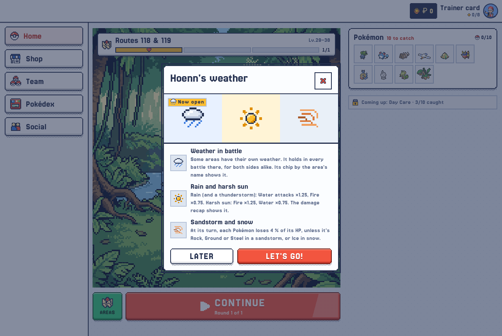 Hoenn's weather: its rules, once | 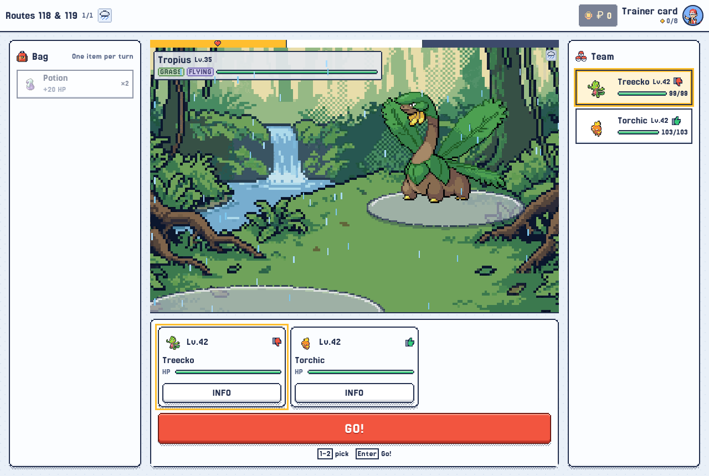 Rain on Routes 118 & 119: the chip by the area's name and on the stage, the rain falling |
| 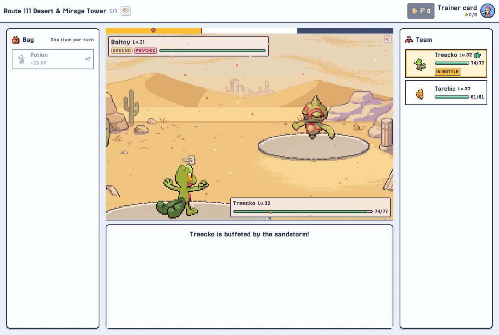 The Route 111 desert's sandstorm wears Treecko down (−3) | 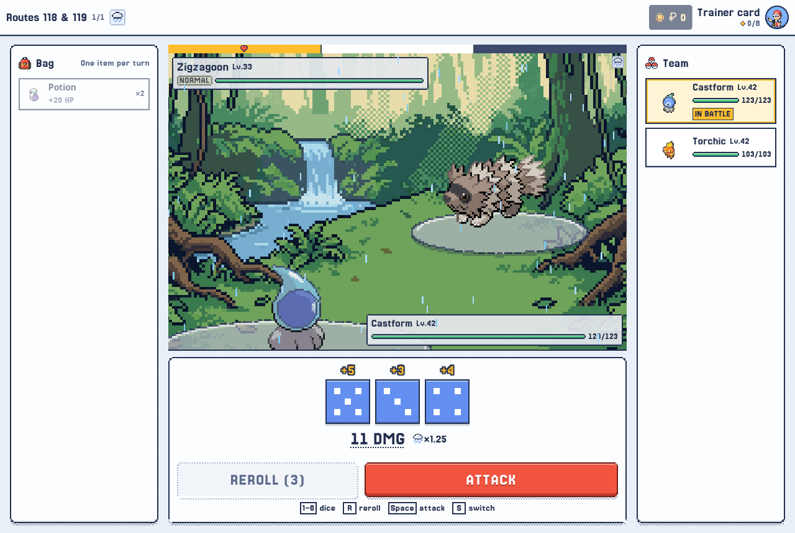 Castform in its Rainy Form: Water dice, rain's ×1.25 |
| 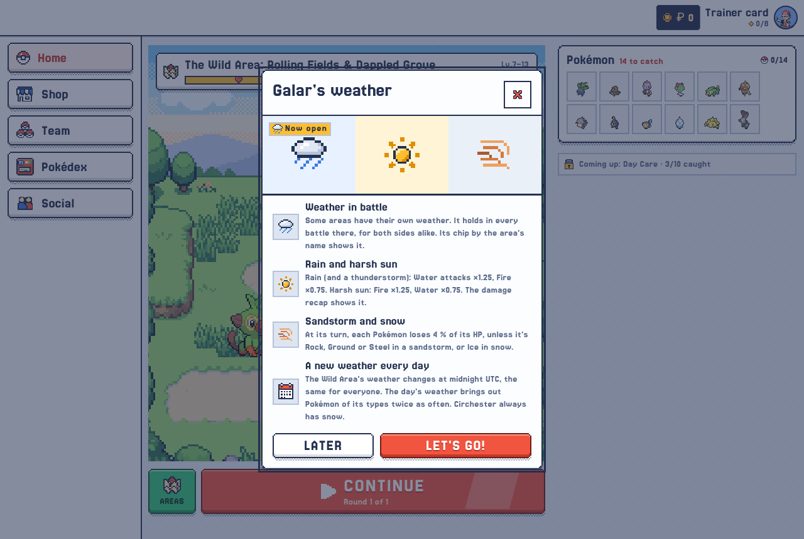 Galar's weather: its rules | |
| 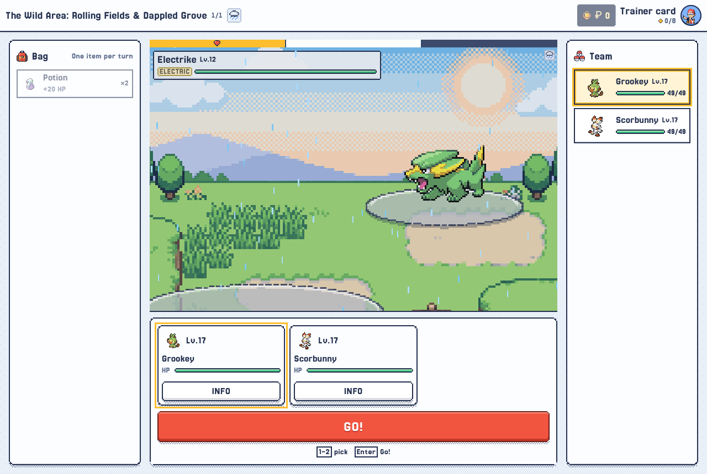 A rainy day in the Rolling Fields | 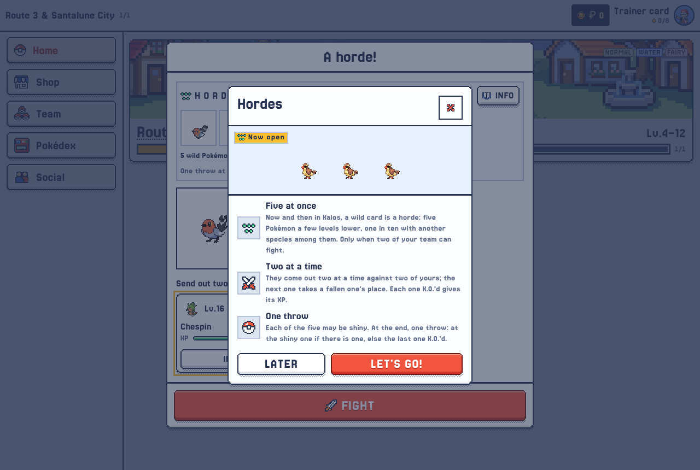 Hordes: the rules, the first time |
| 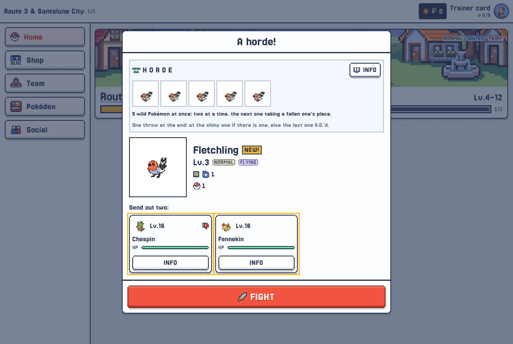 A horde's card | 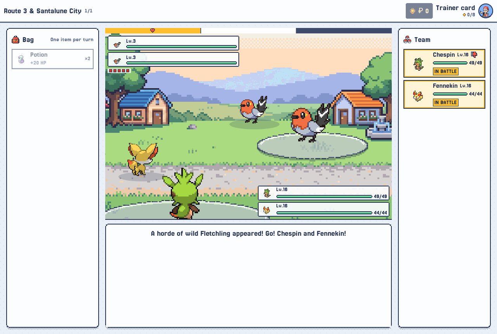 Two at a time, five pips |
| 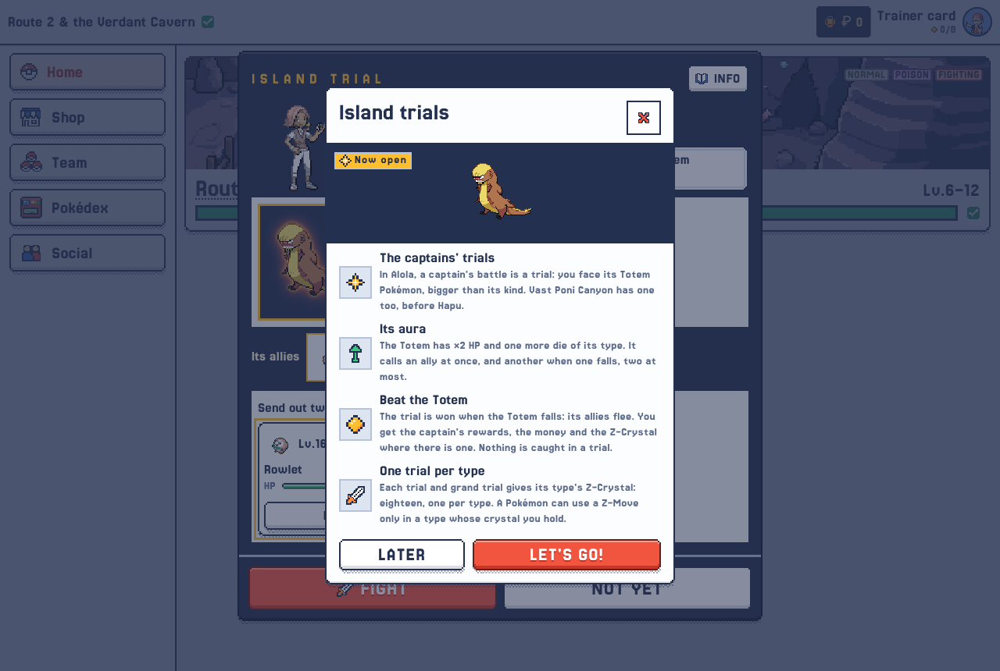 Island trials: the rules | 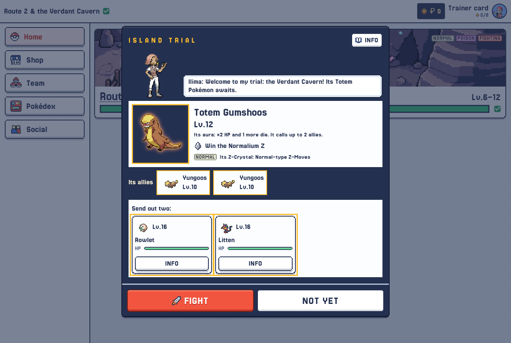 Ilima's trial: Totem Gumshoos and its allies |
| 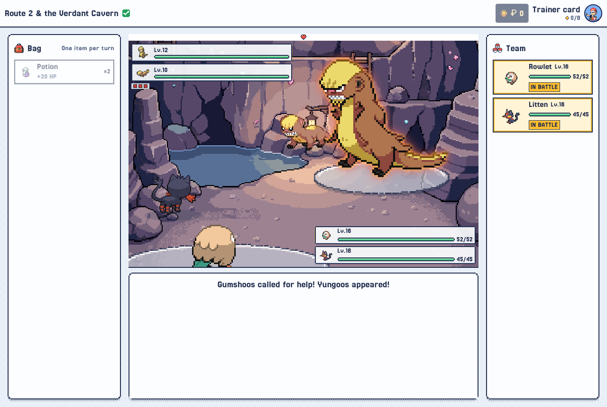 Gumshoos calls for help | 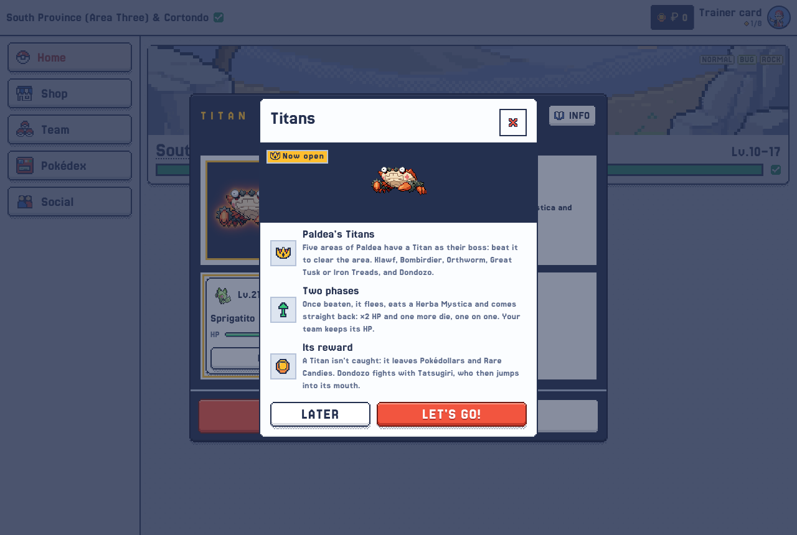 The Titans: the rules |
| 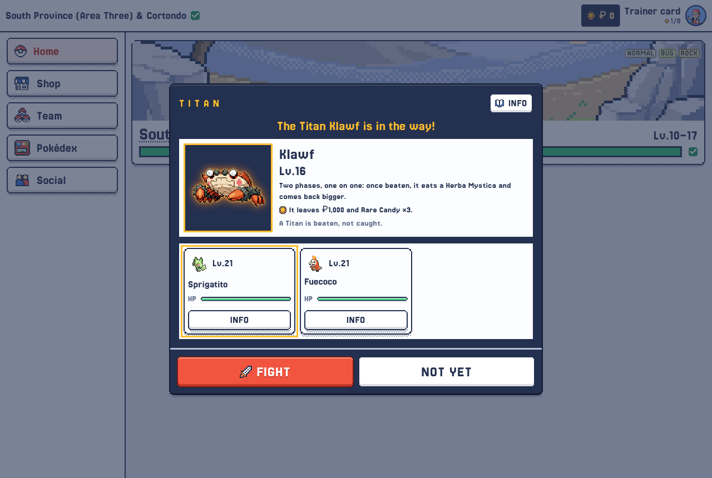 Klawf's card | 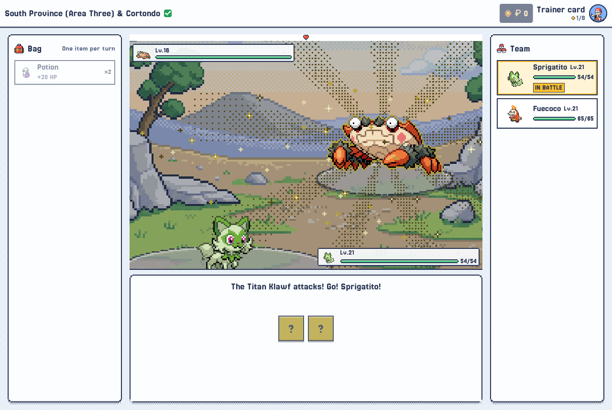 Klawf, the Stony Cliff Titan |
| 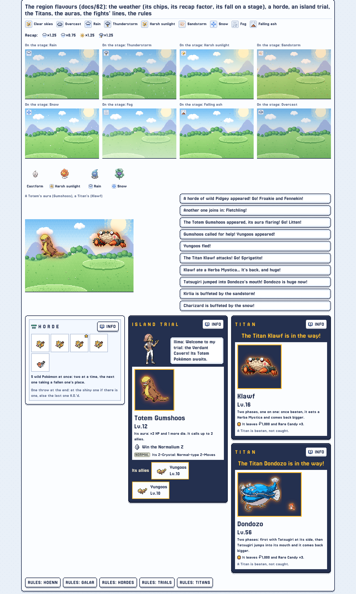 The kitchen sink: every state | |

### Tests

- `tests/engine/region-flavours.test.ts`: the weather (fixed, turns, the day's, the pool's ×, the damage factor, the
  wear, Extreme), hordes (dealt, never off/alone/elsewhere/past the limit, the throw), trials (on/off/Extreme, the
  challenge, Kommo-o's gym, the Totem's HP, die, calls and end), Titans (the boss only while on, beaten not caught, the
  two phases, Commander, Iron Treads, the reward).
- `tests/region-flavours-sql.test.ts`: 0114–0117 on PGlite, twice.
- `e2e/region-flavours.spec.ts`: each part in the game, and its pictures.

## 11. Setting it up

1. Run the four migrations in order (after 0113), in the Supabase SQL editor:
   - [0114_weather.sql](https://github.com/Splifingald/pokedice/blob/ccr-f432a8de-hqqe99/supabase/migrations/0114_weather.sql)
     — the two weather switches, and `side_quest_open` knowing the five keys.
   - [0115_hordes.sql](https://github.com/Splifingald/pokedice/blob/ccr-f432a8de-hqqe99/supabase/migrations/0115_hordes.sql)
     — the hordes' switch.
   - [0116_trials.sql](https://github.com/Splifingald/pokedice/blob/ccr-f432a8de-hqqe99/supabase/migrations/0116_trials.sql)
     — the trials' switch, Totem Kommo-o's row and Vast Poni Canyon's gyms.
   - [0117_titans.sql](https://github.com/Splifingald/pokedice/blob/ccr-f432a8de-hqqe99/supabase/migrations/0117_titans.sql)
     — the Titans' switch and the five bosses.
   - [0118_castform_forms.sql](https://github.com/Splifingald/pokedice/blob/ccr-f432a8de-hqqe99/supabase/migrations/0118_castform_forms.sql)
     — Castform's Sunny, Rainy and Snowy Forms.
   - [0119_type_trials.sql](https://github.com/Splifingald/pokedice/blob/ccr-f432a8de-hqqe99/supabase/migrations/0119_type_trials.sql)
     — the six type trials' Totems (Flying, Poison, Bug, Steel, Psychic, Ice) and their areas' gyms.

   `supabase/seed.sql` carries the data part (the trials' Totems, the gyms, the Titans' bosses, Castform's forms) for a
   fresh database.
2. Admin → Config → Switches: each of the five, Off / On for admin / On for everyone. Admin → Config → Region flavours
   for the numbers.
